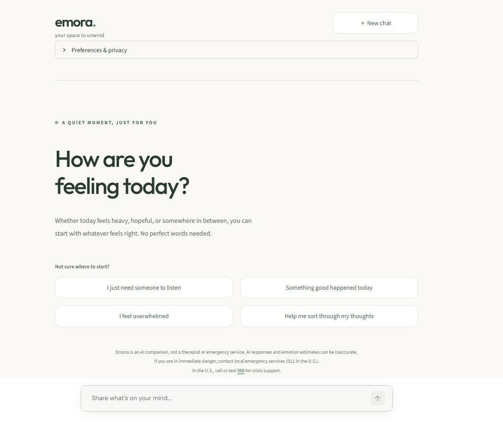
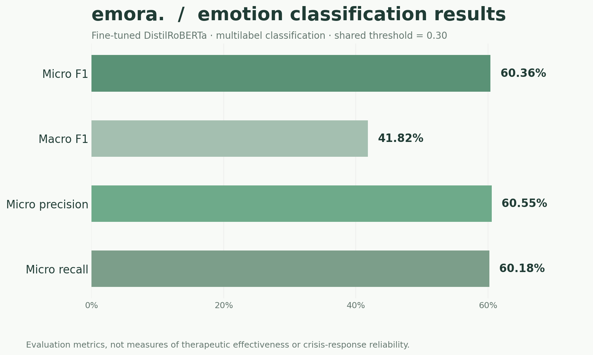

# emora.
### Your space to unwind.

**An emotion-aware AI companion powered by machine learning, natural language processing, and generative AI.**

Emora is an experimental AI companion designed to provide supportive, context-aware conversations. It combines a fine-tuned **DistilRoBERTa emotion classifier**, OpenAI-powered response generation, conversation memory, and rule-based safety screening.

Built as an end-to-end AI/ML project, Emora explores the complete development process—from dataset preparation and traditional machine learning baselines to transformer fine-tuning, evaluation, application development, and cloud deployment preparation.

**Tech Stack:** Python · PyTorch · Hugging Face · Scikit-learn · OpenAI API · Streamlit · Pandas · NumPy

---

## Application Preview

<p align="center">
  
</p>

<p align="center">
  <em>A calm, minimal space for supportive, emotion-aware conversations.</em>
</p>

The Streamlit interface includes conversation starters, chat history, privacy preferences, and an accessible conversational experience.

---

## About Emora

Emora explores a simple idea:

**What if an AI companion could recognize the emotions expressed in a conversation and use that information to respond more thoughtfully?**

Instead of relying exclusively on a generative language model, Emora combines multiple components:

- **Emotion Recognition:** Identifies emotional signals using a fine-tuned DistilRoBERTa classifier.
- **Generative AI:** Uses OpenAI to generate supportive, natural-language responses.
- **Conversation Memory:** Maintains recent context and summarizes relevant conversation history.
- **Safety Screening:** Applies rule-based checks before emotion inference and response generation.
- **Interactive Application:** Provides a minimal, user-friendly interface built with Streamlit.

Emora is an experimental software and machine learning project, not a replacement for professional mental-health care.

---

## System Architecture

<p align="center">
  
</p>

### How It Works

1. **User Input:** A message is submitted through the Streamlit interface.
2. **Safety Screening:** The message is checked for selected crisis-related expressions. Recognized safety situations can trigger a dedicated response path.
3. **Emotion Recognition:** A fine-tuned DistilRoBERTa model performs multilabel emotion classification.
4. **Conversation Memory:** Relevant recent messages and summarized context are made available.
5. **Response Generation:** OpenAI generates a response informed by the emotional signals and conversation context.
6. **User Response:** The generated message is displayed in the application.

The architecture separates emotion classification, safety screening, memory management, and response generation into distinct components.

---

## Machine Learning Development

A major focus of Emora is the experimentation and evaluation behind its emotion recognition system.

### 1. Dataset Preparation

Emora uses **GoEmotions**, a dataset of Reddit comments annotated with 27 emotion categories and a neutral category.

The preprocessing workflow includes:

- Exploring emotion frequencies and class imbalance.
- Preparing multilabel classification targets.
- Organizing training, validation, and test datasets.
- Analyzing text lengths and label distributions.
- Generating visualizations for exploratory analysis.

### 2. Traditional Machine Learning Baselines

Before fine-tuning a transformer, traditional machine learning approaches were developed to establish comparison points.

The experiments include:

- TF-IDF feature extraction.
- Baseline classification models.
- Support Vector Machine classification.
- Decision-threshold tuning.
- Performance comparisons.

These experiments help document the progression from traditional NLP techniques to transformer-based emotion classification.

### 3. Transformer Fine-Tuning

Emora uses a fine-tuned **DistilRoBERTa** model for multilabel emotion recognition.

The model:

- Predicts multiple emotions for a single input.
- Uses sigmoid probabilities for multilabel classification.
- Supports confidence-based prediction thresholds.
- Was evaluated using micro and macro F1 scores, precision, and recall.

The selected configuration uses a shared prediction threshold of **0.30**.

The trained inference model is stored separately from the GitHub source repository, with Hugging Face used for model distribution.

---

## Model Evaluation & Results

<p align="center">
  
</p>

### DistilRoBERTa Evaluation

| Metric | Score |
|---|---:|
| Micro F1 | **0.6036** |
| Macro F1 | **0.4182** |
| Micro Precision | **0.6055** |
| Micro Recall | **0.6018** |

These metrics describe multilabel emotion classification performance, not the clinical effectiveness or conversational quality of the chatbot.

### Threshold Comparison

Two thresholding strategies were evaluated:

| Strategy | Micro F1 | Macro F1 |
|---|---:|---:|
| Shared threshold (0.30) | 0.6036 | 0.4182 |
| Per-emotion thresholds | 0.5873 | 0.4323 |

The shared threshold of 0.30 was selected for the final inference configuration, prioritizing micro F1 performance and a simpler inference strategy.

### Additional Evaluation Visualizations

**Per-Emotion F1 Scores**


**Threshold Strategy Comparison**


**Dataset Emotion Distribution**


Additional evaluation artifacts are available in the `reports/` directory.

---

## Conversational AI & Memory

Emora combines emotion predictions with conversational context to generate responses.

Its conversational pipeline includes:

- Emotion-informed response generation using the OpenAI API.
- Recent conversation history.
- Summarization of earlier context.
- Conversation reset functionality.
- A hybrid architecture connecting structured ML predictions with generative AI.

The goal is to explore how specialized emotion classification can complement general-purpose language models.

---

## Safety & Responsible AI

Emora includes a prototype rule-based safety screening component designed to recognize selected crisis-related expressions.

It supports:

- Screening before normal chatbot response generation.
- Stateful follow-up handling across multiple turns.
- Dedicated responses for recognized safety scenarios.
- Automated regression tests covering selected safety behaviors.

**Important:** Emora is not a therapist, medical device, crisis intervention service, or emergency-response system. Its safety screening is not clinically validated and may fail to recognize dangerous situations. Public deployment requires additional safety and privacy safeguards.

---

## Testing & Performance

The project includes automated and manual tests for:

- Conversation memory behavior.
- Safety screening.
- Multi-turn safety handling.
- Natural-language safety follow-ups.
- Conversation evaluation.
- Model inference and deployment verification.

Development-stage conversation and performance evaluations were also conducted using small, controlled test scenarios. These measurements are exploratory and should not be interpreted as production benchmarks.

Run automated tests with:

```bash
python -m pytest
```

---

## Project Structure

```text
Emora/
├── app/
│   └── streamlit_app.py
│
├── assets/
│   ├── emora-demo.png
│   ├── emora-architecture.png
│   └── emora-ml-results.png
│
├── src/
│   └── emora/
│       ├── data/
│       ├── evaluation/
│       ├── models/
│       └── safety/
│
├── data/
│   ├── processed/
│   └── powerbi/
│
├── models/
├── reports/
│   ├── figures/
│   └── emotion_evaluation/
│
├── tests/
├── scripts/
│
├── legacy/
│   ├── app.py
│   ├── config.py
│   └── agents/
│
├── requirements.txt
├── pytest.ini
├── .gitignore
└── README.md
```

The `legacy/` directory preserves the original Emora implementation and documents the evolution of the project.

The directory structure above assumes the repository cleanup and script reorganization have been completed.

---

## Getting Started

### Prerequisites

- Python and pip
- An OpenAI API key
- Access to the trained emotion classifier on Hugging Face, or a compatible local model

### 1. Clone the Repository

```bash
git clone -b deployment-stage12 https://github.com/RNKCD/Emora.git
cd Emora
```

### 2. Create a Virtual Environment

```bash
python -m venv .venv
```

Activate on Windows:

```powershell
.\.venv\Scripts\Activate.ps1
```

### 3. Install Dependencies

```bash
pip install -r requirements.txt
```

### 4. Configure Environment Variables

Configure the following environment variables in your development environment:

```env
OPENAI_API_KEY=your_openai_api_key
EMORA_MODEL_REPO=your_hugging_face_model_repository
HF_TOKEN=your_hugging_face_read_token
```

`HF_TOKEN` is needed when accessing a private model repository.

Use a secure environment-variable mechanism or a supported local secrets configuration. Do not commit credentials or API tokens to GitHub.

### 5. Run Emora

```bash
streamlit run app/streamlit_app.py
```

Open the local address provided by Streamlit in your browser.

### 6. Run Tests

```bash
python -m pytest
```

---

## Project Evolution

Emora began as a simpler multi-agent chatbot and evolved into a more structured hybrid AI application.

| Component | Original Emora | Current Emora |
|---|---|---|
| Architecture | Initial multi-agent implementation | Modular hybrid AI pipeline |
| Emotion Recognition | Original emotion agent | Fine-tuned DistilRoBERTa |
| Response Generation | Original NLP agent | OpenAI-powered responses |
| Memory | Initial conversation handling | Recent context and summarization |
| Safety | Early functionality | Stateful rule-based screening |
| Evaluation | Initial development | ML metrics and automated tests |
| Interface | Original Streamlit application | Redesigned minimal interface |

The original version remains available in `legacy/` for reference.

---

## Limitations

Emora is a research and portfolio prototype with several limitations:

- Emotion predictions can be inaccurate or incomplete.
- The model may perform differently on text outside its training distribution.
- Rule-based crisis screening cannot identify every emergency.
- Generative AI responses can contain mistakes or inappropriate advice.
- Evaluation results do not demonstrate clinical effectiveness.
- Conversations processed through external APIs may be subject to those providers' data-handling policies.
- Additional privacy, security, and safety measures are needed before broader public deployment.

---

## Future Improvements

- Expand emotion classification robustness testing.
- Evaluate conversational response quality using structured human feedback.
- Improve inference performance and deployment efficiency.
- Explore privacy-conscious conversation management.
- Expand automated regression and integration testing.
- Investigate stronger safety evaluation and monitoring.

---

## Technology Stack

| Category | Technologies |
|---|---|
| Programming | Python |
| Deep Learning | PyTorch, Hugging Face Transformers |
| Emotion Classification | DistilRoBERTa, GoEmotions |
| Traditional ML | Scikit-learn, TF-IDF, SVM |
| Generative AI | OpenAI API |
| Application | Streamlit |
| Data Processing | Pandas, NumPy |
| Visualization | Matplotlib, Power BI data preparation |
| Testing | Pytest |
| Version Control | Git, GitHub |
| Model Distribution | Hugging Face Hub |

---
