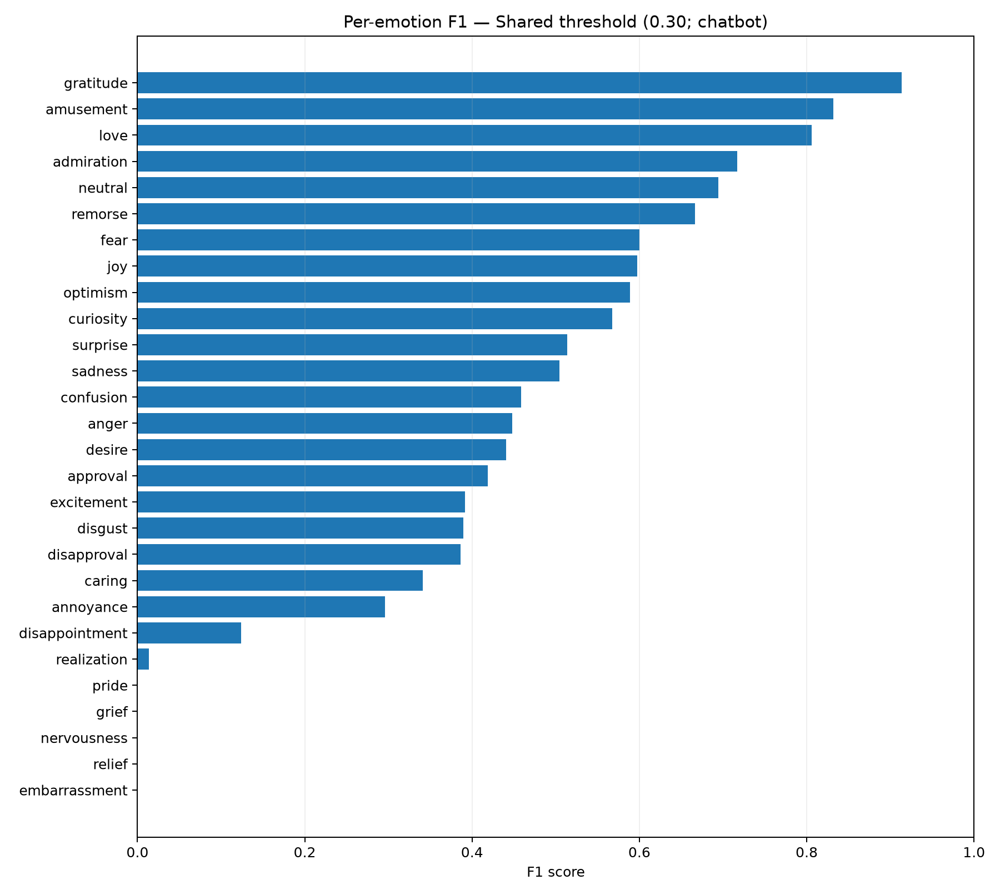
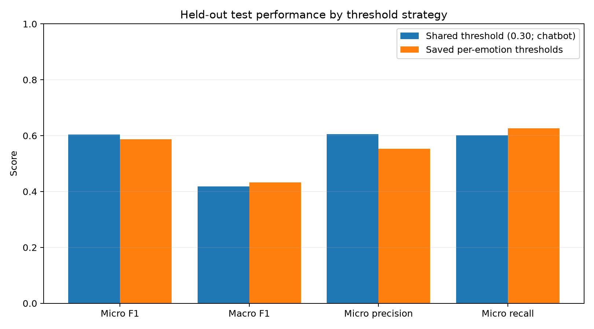
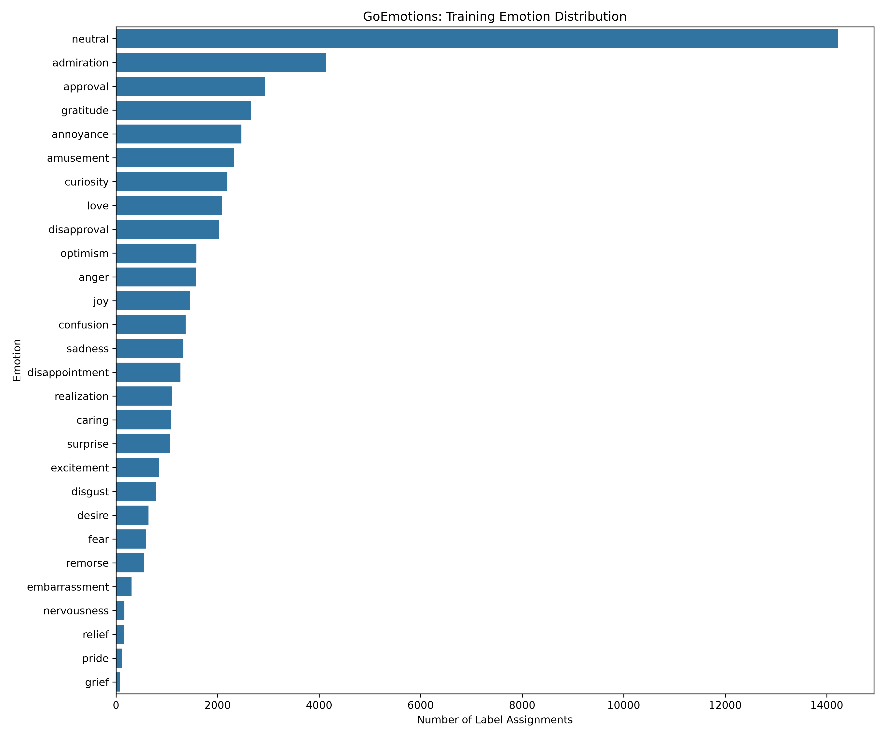

# emora.
### Your space to unwind.

**An emotion-aware AI companion powered by Natural Language Processing, deep learning, and generative AI.**

Emora is an experimental mental-wellness chatbot designed to provide supportive, context-aware conversations. It combines a fine-tuned **DistilRoBERTa emotion classifier**, **OpenAI-powered response generation**, conversation memory, and a rule-based safety screening system.

The project evolved from a simpler multi-agent chatbot into a hybrid AI application, with a focus on machine learning experimentation, model evaluation, conversational AI, and practical deployment.

**Tech Stack:** Python · PyTorch · Hugging Face Transformers · DistilRoBERTa · Scikit-learn · OpenAI API · Streamlit · Pandas · NumPy

---

## Overview

Emora explores a central question:

**Can emotion classification and conversational context improve the design of an AI companion that responds to users in a supportive, natural way?**

Instead of relying exclusively on a generative language model, Emora uses a hybrid architecture:

1. A safety screening component checks incoming messages.
2. A fine-tuned transformer predicts emotions expressed in the text.
3. Conversation memory provides relevant context from earlier exchanges.
4. An OpenAI language model generates a response informed by the conversation and detected emotions.
5. A Streamlit interface presents the interaction.

Emora is a research and portfolio prototype, not a clinical mental-health service.

## Application Features

### Emotion Recognition

- Fine-tuned DistilRoBERTa for multilabel emotion classification.
- Trained using the GoEmotions dataset.
- Predicts multiple emotions from a single message.
- Uses configurable confidence thresholds.
- Provides emotion confidence scores for analysis.

### Context-Aware AI Conversations

- OpenAI-powered response generation.
- Emotion-informed response prompting.
- Recent conversation history and memory summarization.
- Natural-language responses designed to be supportive without unnecessary repetition.

### Safety Screening

- Rule-based detection of selected crisis-related expressions.
- Stateful follow-up handling across conversation turns.
- Immediate-danger escalation for recognized emergency scenarios.
- Regression tests for crisis detection and natural-language reassessment.

**Limitation:** The safety system is a prototype and cannot reliably detect or manage all emergencies.

### Interactive Interface

- Streamlit-based conversational UI.
- Clean, minimal visual design.
- Conversation reset functionality.
- Optional emotion information.
- Privacy and safety information.

---

## Machine Learning Development

Emora was developed through multiple stages of experimentation rather than using a single pretrained model without evaluation.

### 1. Dataset Preparation

The emotion classification component uses the **GoEmotions** dataset, a collection of Reddit comments annotated for 27 emotion categories and neutral.

The data preparation workflow includes:

- Dataset exploration and preprocessing.
- Multilabel target encoding.
- Training, validation, and test splits.
- Emotion frequency analysis.
- Text-length and label-distribution visualizations.

### 2. Traditional Machine Learning Baselines

Traditional machine learning models were developed to establish comparison points before transformer fine-tuning.

Experiments included:

- TF-IDF text vectorization.
- Baseline classification.
- Support Vector Machine classification.
- Decision-threshold tuning.
- Model performance comparisons.

Relevant scripts:

- `src/emora/models/train_baseline.py`
- `src/emora/models/train_svm.py`
- `src/emora/models/tune_threshold.py`

### 3. Transformer Fine-Tuning

A DistilRoBERTa model was fine-tuned for multilabel emotion classification using PyTorch and Hugging Face Transformers.

The classification pipeline uses sigmoid probabilities to allow multiple emotion predictions per message.

Training and experimentation scripts include:

- `train_transformer.py`
- `tune_transformer.py`
- `tune_emotion_thresholds.py`
- `evaluate_transformer.py`

The final inference model is stored separately from the GitHub source repository to avoid committing large model weights.

---

## Model Evaluation

The selected transformer configuration uses a shared classification threshold of **0.30**.

| Metric | Result |
|---|---:|
| Micro F1 | 0.6036 |
| Macro F1 | 0.4182 |
| Micro Precision | 0.6055 |
| Micro Recall | 0.6018 |

These results are from the project's multilabel emotion classification evaluation. They do not measure clinical effectiveness or the quality of mental-health support.

### Evaluation Visualizations

**Per-emotion F1 scores**



**Threshold strategy comparison**



**Emotion distribution**



### Additional Evaluation

Emora also includes scripts for:

- Conversation-level evaluation.
- Response latency measurement.
- Token usage analysis.
- Safety regression testing.
- Memory behavior testing.

Evaluation results and visualizations are organized under `reports/`.

---

## System Architecture


                       User Message
                            |
                            v
                    Streamlit Interface
                            |
                            v
                       Safety Guard
                         /       \
                 Crisis          No Crisis
                   |                 |
                   v                 v
           Safety Response     DistilRoBERTa
                               Emotion Model
                                    |
                                    v
                             Emotion Predictions
                                    |
                                    v
                           Conversation Memory
                                    |
                                    v
                             OpenAI Response
                                Generator
                                    |
                                    v
                            Generated Response
                                    |
                                    v
                            Streamlit Interface
```

The safety component runs before emotion inference and language-model generation.

The emotion classifier provides structured signals, while the language model handles conversational response generation.

---

## Project Structure

Emora/
├── app/
│   └── streamlit_app.py
│
├── src/emora/
│   ├── data/
│   ├── models/
│   ├── evaluation/
│   └── safety/
│
├── data/
│   ├── processed/
│   └── powerbi/
│
├── models/
│   └── [traditional ML artifacts]
│
├── reports/
│   ├── figures/
│   └── emotion_evaluation/
│
├── tests/
├── scripts/
├── legacy/
│   ├── app.py
│   ├── config.py
│   └── agents/
│
├── requirements.txt
├── pytest.ini
├── .gitignore
└── README.md
```

The `legacy/` directory preserves the original Emora implementation, while the current application is maintained under `app/` and `src/emora/`.

---

## Getting Started

### Prerequisites

- Python and pip
- An OpenAI API key
- Access to the trained emotion classifier on Hugging Face, or a compatible local model

### 1. Clone the Repository

```bash
git clone https://github.com/RNKCD/Emora.git
cd Emora
```

### 2. Create a Virtual Environment

```bash
python -m venv .venv
```

Activate it on Windows:

```powershell
.\.venv\Scripts\Activate.ps1
```

### 3. Install Dependencies

```bash
pip install -r requirements.txt
```

### 4. Configure Environment Variables

Create a local `.env` file with the required configuration:

```env
OPENAI_API_KEY=your_openai_api_key
EMORA_MODEL_REPO=your_hugging_face_model_repo
HF_TOKEN=your_hugging_face_read_token
```

Do not commit `.env` or any API tokens to GitHub.

### 5. Launch Emora

```bash
streamlit run app/streamlit_app.py
```

### 6. Run Automated Tests

```bash
python -m pytest
```

Deployment environments must be configured with their own secrets and model access permissions.

---

## Emora 1.0 vs. Emora 2.0

| Area | Emora 1.0 | Emora 2.0 |
|---|---|---|
| Architecture | Initial multi-agent chatbot | Hybrid ML and generative AI |
| Emotion understanding | Original emotion agent | Fine-tuned DistilRoBERTa |
| Conversation generation | Original NLP agent | OpenAI-powered generation |
| Memory | Initial implementation | Recent history and summarization |
| Safety | Initial functionality | Stateful rule-based screening |
| Evaluation | Early experimentation | ML, conversation, performance, and regression testing |
| Interface | Original application | Redesigned Streamlit experience |

The original implementation is preserved under `legacy/` to document the project's evolution.

---

## Limitations and Responsible Use

Emora is an experimental AI companion built for software engineering and machine learning research.

- It is not a therapist, medical device, or emergency-response service.
- Emotion predictions may be incorrect, especially for ambiguous or unfamiliar language.
- The safety guard relies on rules and cannot reliably identify every crisis.
- Generative responses can be inaccurate or inappropriate.
- Model evaluation metrics do not establish clinical effectiveness.
- Conversations may be processed by third-party API providers.
- Sensitive conversation data should not be publicly logged or included in the repository.

Public deployment requires additional security, privacy, safety, and abuse-prevention work.

---

## Future Improvements

- Expand evaluation across varied conversational scenarios.
- Improve robustness of emotion recognition.
- Investigate safer and more flexible conversational risk assessment.
- Evaluate response quality using structured human feedback.
- Add privacy-conscious analytics and monitoring.
- Improve model inference efficiency and deployment reliability.

---

## Technologies

**Languages:** Python

**Machine Learning:** PyTorch, Hugging Face Transformers, Scikit-learn, DistilRoBERTa

**NLP:** Multilabel emotion classification, TF-IDF, transformer fine-tuning

**Generative AI:** OpenAI API, prompt engineering, conversation memory

**Application:** Streamlit

**Data Analysis:** Pandas, NumPy, Matplotlib, Power BI data preparation

**Testing and Development:** Pytest, Git, GitHub

---


---

*Emora — Your space to unwind.*
